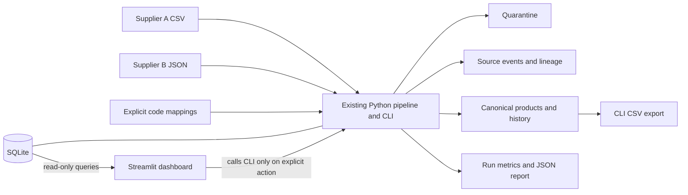

# SupplierSync

## Project overview

SupplierSync is a local data engineering demo for combining supplier product feeds with different schemas and product codes. It validates and normalizes records, maps known supplier products to canonical IDs, keeps source-level audit evidence, quarantines rejected data, and publishes a current product view to SQLite.

The core pipeline and CLI use Python's standard library. An optional Streamlit dashboard provides a local interface for running the CLI and exploring products, source lineage, quarantine, and run reconciliation. The dashboard does not replace pipeline logic.

## Features

- Reads Supplier A CSV and Supplier B JSON files using their documented schemas.
- Uses explicit supplier-code mappings; product identity is never inferred from names.
- Normalizes names, categories, currencies, prices, and timezone-aware timestamps.
- Applies deterministic conflict resolution: newest source timestamp wins; ties prefer Supplier A and then the ascending source record ID.
- Validates required fields, prices, timestamps, duplicate source keys, malformed records, and invalid mappings.
- Preserves accepted raw and normalized source values, rejected payloads and reasons, winning lineage, and canonical product history.
- Persists products, source events, quarantine, product history, and run metrics in SQLite.
- Supports idempotent event replays and JSON reconciliation reports.
- Includes a deterministic synthetic data generator, CLI export/report commands, benchmark, and optional dashboard.

## Architecture



See [docs/architecture.md](docs/architecture.md), [docs/data_dictionary.md](docs/data_dictionary.md), and [docs/design_decisions.md](docs/design_decisions.md) for data flow, schema, assumptions, and trade-offs.

## Requirements

- Python 3.11 or newer, as declared in `pyproject.toml`. Setup and verification have been run with Python 3.14.3.
- macOS, Linux, or Windows with PowerShell.
- Internet access to install packages from PyPI. Runtime CLI dependencies are otherwise in the standard library.

## Install

macOS/Linux:

```bash
git clone https://github.com/rupali026-r/SupplierSync.git
cd SupplierSync

python3 -m venv .venv
source .venv/bin/activate
python -m pip install --upgrade pip
python -m pip install -e '.[dev,dashboard]'
```

Windows PowerShell:

```powershell
git clone https://github.com/rupali026-r/SupplierSync.git
cd SupplierSync

py -m venv .venv
.\.venv\Scripts\Activate.ps1
python -m pip install --upgrade pip
python -m pip install -e ".[dev,dashboard]"
```

The `dev` extra installs pytest. The `dashboard` extra installs Streamlit and its dependencies; Streamlit is not a core pipeline dependency. To install only the CLI and tests, use `python -m pip install -e '.[dev]'` (PowerShell: `python -m pip install -e ".[dev]"`).

## Quick start: CLI

Run these commands from the repository root with the virtual environment active. The sample location below is ignored by Git and is separate from the tracked example inputs.

```bash
suppliersync generate --output .suppliersync_demo/cli-sample/input --records 40 --seed 1729
suppliersync run --input .suppliersync_demo/cli-sample/input --db .suppliersync_demo/cli.sqlite --report .suppliersync_demo/cli-report.json
suppliersync export --db .suppliersync_demo/cli.sqlite --output .suppliersync_demo/products.csv
suppliersync report --db .suppliersync_demo/cli.sqlite
pytest -q
python scripts/benchmark.py --records 100000
```

The generator places `product_mappings.json` beside the input directory in a `reference/` folder. It creates eight deterministic edge-case rows in addition to the requested valid feed volume, so `--records 40` produces 48 total input rows. Generate into a new directory; the CLI generator writes files at its target and can replace files already there.

The dashboard's **Generate fresh deterministic sample** control creates a unique timestamped directory instead of overwriting existing files. CLI run/export/report defaults point at `data/suppliersync.db`, `reports/latest.json`, and `outputs/products.csv`; the sample commands above intentionally use ignored demo paths to avoid changing those tracked assessment artifacts.

## Quick start: dashboard

```bash
streamlit run app.py
```

Open the local URL printed by Streamlit, usually [http://localhost:8501](http://localhost:8501). The dashboard starts with `data/input` selected. Use the sidebar's sample-generation control to create a fresh input set safely, or select another input directory inside the project. Press **Run Pipeline** to invoke the existing CLI.

Dashboard executions write to `.suppliersync_demo/suppliersync_demo.db` and `.suppliersync_demo/latest.json` by default. They do not use `data/suppliersync.db`. Database inspection uses read-only SQLite connections. Product CSV, selected quarantine CSV, and run JSON downloads are generated from the selected database records. Press Ctrl+C in the terminal to stop Streamlit.

Windows PowerShell uses the same launch command after activating `.venv`:

```powershell
streamlit run app.py
```

The dashboard accepts project-local input and output paths only. It blocks the primary working database path; custom database paths must stay inside this repository. The app is designed for local assessment use and has no authentication or hardening for untrusted network exposure.

## Demo workflow

1. Install the `dev` and `dashboard` extras.
2. Generate a deterministic sample with the CLI into a new ignored directory or use the dashboard's safe generator.
3. Launch Streamlit with `streamlit run app.py`.
4. Select the generated input directory and press **Run Pipeline**.
5. Review run status, accepted/rejected/duplicate counts, and the reconciliation result.
6. Browse canonical products and inspect their accepted source observations and product history.
7. Filter quarantine by supplier or rejection reason and inspect raw payloads.
8. Run the same inputs again; persisted event fingerprints should classify them as duplicates.
9. Download product and quarantine CSVs or a run JSON report.

## Deterministic sample results

For the documented seed and a fresh database, the existing verification reports **48 inputs, 42 accepted, 6 rejected, and 10 current canonical products**. Replaying those same inputs reports **48 duplicates** and adds no products, source events, or history rows. The reconciliation equation balances. These are verified fixture results, not guaranteed counts for arbitrary feeds.

## Tests and benchmark

Run the complete test suite with:

```bash
pytest -q
```

Dashboard and pipeline tests use temporary SQLite databases and directories. The latest dashboard implementation verification is recorded in [docs/verification.md](docs/verification.md). The benchmark command is `python scripts/benchmark.py --records 100000`; recorded measurements and environment are in that document. Benchmark timings describe one run on one machine and are not performance guarantees.

## Configuration and file locations

| Path | Purpose |
| --- | --- |
| `data/input/` | Tracked, reproducible sample supplier feeds |
| `data/reference/product_mappings.json` | Tracked explicit supplier-to-product mapping |
| `data/expected/` | Expected generator and reconciliation results |
| `outputs/products.csv` | Tracked example export |
| `reports/latest.json` | Tracked example report; point new local runs elsewhere |
| `data/suppliersync.db` | CLI default database; not created by the dashboard |
| `.suppliersync_demo/` | Ignored local dashboard, CLI demo, report, and generated sample files |

The dashboard sidebar configures its input directory and database path. For safety, these paths must remain inside the project; dashboard writes may not target `data/suppliersync.db`. Dashboard-triggered runs occur only after an explicit button press.

## Troubleshooting

- **`streamlit: command not found`**: activate `.venv` and run `python -m pip install -e '.[dev,dashboard]'`; alternatively use `.venv/bin/streamlit run app.py` (Windows: `.venv\Scripts\streamlit.exe run app.py`).
- **Wrong interpreter or missing dependencies**: check `python --version` and `python -m pip show streamlit`; install extras using the same `python` executable that launches the app.
- **Port 8501 is in use**: launch with `streamlit run app.py --server.port 8502` and open the URL Streamlit prints.
- **Missing sample inputs**: select an existing project directory containing supported supplier files or create a fresh sample in the sidebar. An empty/missing directory is reported instead of starting a run.
- **SQLite locked**: close other writers and retry. SQLite serializes writers; this demo does not coordinate distributed writers.
- **Malformed SQLite database**: inspect or move the chosen demo database only after preserving any data you need; the dashboard reports database read errors and does not silently migrate a database during inspection.
- **Empty overview**: no run is recorded in the selected database yet. Generate/select input data and press **Run Pipeline**.
- **Invalid report JSON**: the dashboard shows the report error. When the original JSON is unavailable for a selected historical run, it offers a clearly labelled report reconstructed from the persisted run row.
- **CSV/JSON download**: retry from the relevant table or use the CLI export. Empty result sets disable CSV downloads; JSON exports require a persisted run.
- **macOS/Linux activation**: `source .venv/bin/activate`. **Windows PowerShell activation**: `.\.venv\Scripts\Activate.ps1`. If script execution policy blocks activation, follow your organization's PowerShell policy or call `.venv\Scripts\python.exe` directly.

## Limitations and security

- Only the known `supplier_a.csv` and `supplier_b.json` filenames and schemas are ingested. Unknown supplier files are ignored; added input fields are retained in source payloads; missing required fields are rejected.
- Product matching requires an explicit mapping. The pipeline does not use fuzzy names.
- The batch parser and candidate set are held in memory; see design decisions for a possible SQLite staging optimization.
- Mapping changes do not remap already fingerprinted source events automatically; a deliberate rebuild/backfill is required.
- This is a local single-process assessment demo, not an authenticated production service. Do not expose Streamlit to untrusted networks or use it for confidential supplier data.
- Dashboard queries are read-only and parameterized. Dashboard-triggered writes use a dedicated demo database by default, and generated demo artifacts are ignored by Git.

## Repository structure

```text
app.py                         Streamlit dashboard
src/suppliersync/              Pipeline, CLI, generator, dashboard query helpers
tests/                         Pipeline and dashboard data tests
data/input/                    Supplier A CSV and Supplier B JSON examples
data/reference/                Explicit product mappings
data/expected/                 Separate expected sample results
docs/                          Architecture, schema, decisions, verification, AI prompts
scripts/benchmark.py           Reproducible throughput benchmark
```

## Contribution and AI usage

The original user prompts and an accurate record of later dashboard work are retained in [docs/ai_prompt_history.md](docs/ai_prompt_history.md). AI assistance was used for implementation and documentation; commands and measured results are recorded only after they were actually run.
