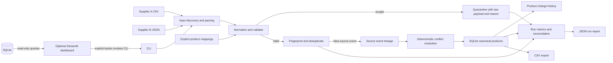

# Architecture

The CLI discovers known supplier filenames (`supplier_a.csv` and `supplier_b.json`), parses rows, validates the supplier-specific schema, standardizes values, resolves explicit product mappings, and stages accepted events and quarantine records in SQLite. The current canonical row is selected among newly observed records per product by latest `updated_at`; timestamp ties use supplier A before supplier B, then ascending source record ID. Previously published newer values cannot be replaced by late older observations. Only a changed canonical projection creates a history row. The transaction protects the publish of event, quarantine, history, and product state. A failed transaction leaves a run row and counts rolled-back records as unprocessed.

For a compact single-process assessment workload, the implementation reads parsed records into memory before publishing. The benchmark measures this real path. A future streaming/batched staging design would reduce peak memory at the cost of more complex cross-file deterministic selection and transaction management.

The optional dashboard is a presentation and inspection layer. Its query helpers use SQLite URI `mode=ro` connections and parameterized filters. A dashboard run invokes the existing CLI in a subprocess only after the user presses **Run Pipeline**. The default database, report, and generated sample area are under the ignored `.suppliersync_demo/` directory; the tracked working database path is blocked. Sample generation chooses a new timestamped folder so it does not replace existing inputs.
